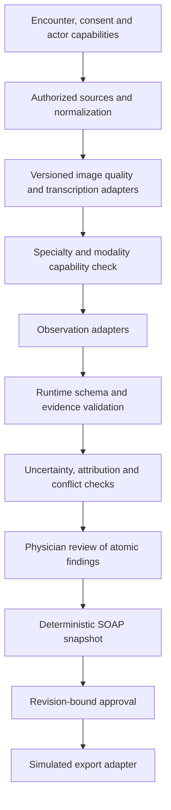

# SpotCheckMD architecture review and proposal

Status: proposed, awaiting agreement on the next development priority. No application changes accompany this review.

Reviewed on October 23, 2026 against `main` commit `1672fa65b51d1391e797c49725c3bfac4ffac32b`. The downloaded workspace matched all 17 tracked files byte-for-byte. Review covered every tracked source, script, configuration file, the README, evaluation documentation, and the lockfile's dependency metadata. Ignored local encounter data, credentials, generated output, and dependency implementation code were excluded. The repository has no existing AGENTS.md, CI workflow, dedicated unit-test suite, or evaluated-case results at this baseline.

## Current behavior and architecture

| Area | What exists | Boundaries |
| --- | --- | --- |
| Client | Single React dashboard, fictional encounter selection, microphone capture, JPEG/PNG upload/camera input, QR pairing, manual findings, review and SOAP preview | Aura branding; two hard-coded profiles; no separate specialty selector or automatic cross-device refresh |
| Pairing and access | Anonymous 8-hour cookies, encounter-scoped paired sessions, hashed one-use pairing tokens expiring after 5 minutes, origin checks | Possession grants access; no authenticated physician identity or capture/reviewer roles |
| Media | Sharp EXIF orientation, metadata stripping, lossless full-dimension PNG inference copy, separate JPEG preview, brightness/detail/resolution warnings | Ordinary JPEG/PNG photos only; configurable 50 MB/60 MP defaults; no HEIC, DICOM, video, PDF, vitals, lab, or structured record ingestion |
| Audio | One uploaded recording per encounter; server transcription | One transcript string, no populated segment timestamps, no diarization or transcript correction workflow |
| Analysis | Direct OpenAI calls, strict response schema request, up to 10 atomic suggestions, source-ID and case-insensitive transcript-substring checks | Shared prompt with a `skin`/`throat` label; no specialty-specific algorithm or runtime response schema parser |
| Review | Pending/accepted/rejected findings, reviewer edits, manual additions, uncertainty notes, basic left/right conflict flags | Evidence is source ID plus free-text quote/description; no proof that a quote entails the claim or a visible region supports it |
| SOAP | Deterministic grouping by S/O/A/P, source IDs, limitations and reviewer notes in composed text | No second model pass to invent a narrative; missing sections say “Not documented.” |
| Approval/export | Shared blockers, revision checks, note digest, approval invalidation, idempotent local export marker | Simulation only, not FHIR/EHR transport; clinician name is self-asserted |
| Persistence | JSON and media on disk, atomic JSON replacement, in-process lock, action/revision audit entries | Single process; no transactional database, schema migrations, durable jobs, retention workflow, or tamper-evident audit |
| Evaluation | Written protocol plus count aggregation by skin tone, lighting, accent and terminology | Protocol explicitly not run; no supplied results or specialty/modality stratification |

Primary ownership is `app/page.tsx` (UI), `app/api/demo/route.ts` (HTTP/lifecycle orchestration), `lib/analysis.ts` (all AI and image operations), `lib/domain.ts` (shared domain and note rules), and `lib/store.ts` (persistence/access).

Uploads accept JPEG/PNG images up to 10 MiB and supported audio MIME types up to 20 MiB. Uploads are blocked when the existing source count is at least eight; transcription adds another source outside this check. Uploading media clears findings/conflicts; successful reanalysis replaces findings and can leave older transcript sources behind. This is not a revisioned evidence history.

## Findings that affect expansion

The domain's source/finding/review/note separation is a useful foundation for multiple specialties. Expansion is practical inside the current app, but the implementation is not yet a specialty framework. `skin` and `throat` conflate body site with clinical specialty, patient profiles determine that value, and it only changes text in one prompt. Primary care and urgent care should not become aliases for anatomy labels.

The following are implementation findings, not clinical performance measurements:

1. **Approval has no reviewer role boundary.** `auth()` scopes the encounter but does not distinguish capture from review authority. Paired sessions can call review, approve, and export; the existing smoke script does so. Preserve the demo labeling and add explicit capabilities before presenting this as authenticated physician approval.
2. **Evidence checks are structural and incomplete.** `suggest()` validates source membership and quote substrings, but JSON is type-asserted rather than runtime-validated. Whitespace-only evidence can pass the current truthiness/substr checks. Manual transcript quotes are not checked against transcript text. Clinician edits keep the old evidence and require only an explanatory note. This needs typed evidence and consistent validation across AI/manual/edit paths; even then, semantic support still needs physician inspection.
3. **Clinical restrictions mostly live in prompts.** The server does not independently enforce visual observations in O or transcript/clinician provenance for A/P. `origin` collapses mixed image/transcript findings into `visual`. A valid source ID is not permission to add a diagnosis or treatment. Separate claim type, attribution, and SOAP placement, with server policies and clinical review.
4. **Concurrent changes can strand analysis.** After marking a snapshot running, a confirmation/review/manual change can advance the revision while leaving `analysis === "running"`. Completion rejects the old revision; the catch block only clears running for an exact revision match. A later analyze call rejects the still-running encounter. This path is identified by static inspection; use a controllable provider stub to reproduce it before fixing it.
5. **Analysis provenance is too coarse.** An encounter-level model string and static `visual-v1` prompt version do not capture which run produced each finding, the transcription model separately, input revisions, normalization transforms, or specialty policy. Retry/reanalysis should not silently erase reviewer work.
6. **Review displays can diverge from composed text.** The SOAP panel shows text and IDs but omits certainty, limitations, and reviewer notes included by `composeNote()`. The copy button is available on drafts and copied pending lines do not carry explicit pending markers. Make draft/approved status and reviewed content consistent across preview, clipboard, and export.
7. **Conflicts are a string heuristic.** Any visual/spoken left/right combination can be flagged regardless of anatomy; edits do not recompute conflicts. It cannot detect negation, temporal differences, contradictory history, or incorrect patient attribution. Keep limitations explicit rather than implying complete contradiction detection.
8. **Quality and ingestion are photo-specific.** Generic brightness/detail thresholds are not specialty or modality validation. Retake images are still sent for analysis, although accepted findings referencing them block approval. Image processing occurs before session/consent checks inside upload's transaction, and limits are checked after multipart parsing. Future ingestion should authorize first and bound resource use at the request/decode boundary.
9. **Persistence and audit constrain deployment.** The lock is process-local, media writes and JSON persistence are not one transaction, and expired sessions do not delete encounter/media data. The audit lacks actor IDs, before/after values and immutable run history. These are demo constraints, not compliance guarantees.
10. **Tests do not establish model quality.** There is no unit/CI setup. Smoke coverage exercises manual findings without live AI by default. Evaluation accepts integer counts without rejecting negative/impossible totals and prints rates plus case N rather than all metric denominators promised in the protocol. Live transcription/model availability, browser/phone capture, and subgroup clinical performance remain unverified.

## Proposed modular pipeline

Keep Next.js and the existing review journey. Start with modules and explicit contracts within one application; a microservice architecture, vector database, or training pipeline is not needed for this milestone.

Unsupported inputs return a clear unsupported/not-assessable result without being silently routed through an unrelated specialty model. Existing valid observations and reviewer work should be preserved when a modality fails, but stale results must not replace the current encounter revision.

| Proposed boundary | Responsibility | Initial implementation strategy |
| --- | --- | --- |
| Domain/contracts | Versioned encounters, sources, findings, runs, evidence, review and approvals | Evolve existing types; runtime validation at boundaries, using the already installed Zod if suitable |
| Ingestion | Authorization, consent, size/type/decode limits, source IDs, media normalization/provenance | Extract existing upload/Sharp logic without expanding accepted formats |
| Transcription adapter | Provider request, transcript segments, transcription provenance, explicit unknown speaker | Wrap existing call first; offsets/timestamps only when actually supplied or verified |
| Observation adapter | Supported modalities, provider/model configuration, structured observations, failures | Wrap current vision/text call; separate photo observations from attributed transcript statements; reconcile with shared provenance |
| Specialty registry | Supported input/task matrix, concept vocabulary, templates, extra quality checks and evaluation fixtures | Plain versioned configuration plus small functions; preserve legacy demos through explicit migration/mapping |
| Evidence/policy service | Source ownership/version checks, quote spans, attribution, section rules, unsupported modality handling | Shared by model output, manual additions and edits; cannot certify clinical truth |
| Analysis orchestrator | Run IDs, input revision, cancellation/supersession, timeout/retry state, partial results | Explicit state machine in the current server before considering a queue |
| Review/note service | Human edits and decisions, conflict resolution, deterministic SOAP rendering, approval snapshot | Extract existing rules and keep one rendering contract for preview/export |
| Persistence/export interfaces | Store versioned records and export approved immutable snapshots | Wrap local JSON and simulation first; replace adapters later when requirements justify it |

### Domain contracts to agree on

- **Encounter context:** distinguish `specialtyId`, `bodySite`, `modality`, and intended documentation task. Record selected policy version; do not infer specialty from a patient identity or silently change a saved encounter's semantics.
- **Source:** stable encounter-local ID; source kind; source version/digest; normalization details and retained-media reference; provenance/authorization metadata without unnecessary identifying data. New document/lab/vitals adapters are future work with their own schemas.
- **Evidence reference:** a discriminated union for image region descriptions (optional coordinates only when supplied), transcript segment IDs and verified character spans (optional actual time bounds), and clinician attestations. Unknown location/timing stays unknown. Each reference points to a specific source version.
- **Observation:** atomic wording; claim type such as patient report, visible observation, clinician assessment or clinician plan; polarity/negation and temporality when supported; uncertainty and limitations; one or more typed evidence references; generating run ID; original wording and review history. An optional concept ID is a vocabulary mapping, not proof of a learned concept attribution.
- **Analysis run:** stable ID, input revision/source versions, provider/model identifiers, prompt/schema/preprocessing/specialty versions, running/succeeded/failed/cancelled/superseded state and redacted failure metadata. Completion updates only the run that owns the current execution; stale work cannot overwrite newer edits or leave the encounter permanently busy.
- **Approval/export:** authenticated actor capabilities when implemented, approved content revision/digest, immutable snapshot and provenance. Preserve the current simulation; a future real adapter must separately handle patient identity, authorization, mapping, retries and idempotency.

Keep clinical interpretations distinct from observed findings. Only explicitly attributed clinician assessment/plan or clinician-authored content should populate A/P after review. Transcript ambiguity must be surfaced rather than resolved by guessing a speaker. Human approval is required, but it is not a substitute for input/output validation.

### Specialty profiles

Start with a general documentation profile and explicit legacy skin/throat demo compatibility. A specialty profile should declare allowed modalities/tasks, observable concept vocabulary, extra quality requirements, prompt/schema versions and relevant review/evaluation fixtures. Shared provenance, consent, approval and export rules remain mandatory.

Potential dermatology concepts can support descriptive review of appearance, without diagnosis. If an ABCDE-oriented workflow is later selected, diameter needs an actual measurement source and evolution needs temporal evidence; do not fabricate either from one unscaled photograph. Primary care can prioritize attributed symptoms and clinician observations. Urgent care can prioritize descriptions of visible injury or swelling, without inferring severity, cause or treatment. These are proposed scopes requiring targeted evaluation, not implemented or validated capabilities.

Do not route radiographs, pathology slides, ultrasound, or other specialist images through a generic photograph adapter solely because a file is JPEG. File format and clinical modality are different checks.

### CLEAR research boundary

The authors describe CLEAR as a chest-X-ray representation model linking images to radiological concepts and enabling weighted concept-level analysis. This is different from a language model returning source IDs or descriptive text. Its released implementation is for research and is not validated for clinical decision-making. See the [published paper](https://www.nature.com/articles/s41551-026-01741-4) and [author-maintained implementation](https://github.com/peterhan91/CLEAR).

Our recommendation is to adopt explicit concepts and provenance as design principles now, while keeping any CLEAR experiment behind a separate chest-X-ray research adapter. Do not add it to the hackathon's default photo pipeline. Cross-specialty adaptation would require an appropriate concept vocabulary, authorized modality-specific data, suitable model training/adaptation, and independent evaluation. Preserve concept-bank/model versions and distinguish model-derived contribution scores from calibrated probabilities or confirmed clinical findings.

## Recommended order of work

1. **Agree on a reliability and evidence-contract milestone.** Preserve the current demo, extract provider/orchestrator boundaries, add runtime schemas and typed provenance with a saved-data migration plan, fix stale-run recovery, and distinguish capture from reviewer capabilities. Test these with deterministic provider fixtures. Demo role separation alone must not be marketed as clinician authentication.
2. **Introduce specialty configuration.** Separate specialty/body site/modality, preserve existing demos, add a general documentation profile and one explicitly chosen new specialty scenario. Acceptance requires source-linked observations, explicit unsupported states, and no relaxation of approval rules.
3. **Improve review fidelity and evaluation.** Align preview/clipboard/approved rendering; add verified transcript navigation and edit history; expand reference cases by specialty/modality and strengthen metric validation and denominator reporting. Include failures and not-assessable cases, paired baseline comparisons, and reviewer time. No clinical claim follows from small demo samples.
4. **Explore CLEAR independently.** Only after a specific chest-X-ray research objective, authorized dataset, compute plan and evaluation criteria are agreed. This should not block the documentation workflow.
5. **Treat real deployment as a separate project.** Real authentication, transactional storage, retention, vendor/privacy review, audit controls, clinical validation, and a true EHR sandbox adapter require their own requirements and review.

For the first milestone, acceptance tests should cover malformed responses, empty/invalid evidence, cross-encounter references, manual transcript mismatches, visual A/P violations, retake/limited quality, ambiguous speakers, empty model output, upstream failures, consent revocation, concurrent edits, superseded runs, review invalidation, capture-only approval denial, and idempotent export of exactly the approved snapshot. Preserve the existing happy path and test old saved encounters before migrating fields.

## Baseline validation

Checks run in an isolated checkout with Node v24.22.1 and npm 11.19.1:

- `npm ci`: passed; lockfile unchanged.
- `npm run build`: passed, including Next.js compilation and TypeScript checks.
- `npm run typecheck`: passed after build generated the route types.
- `SMOKE_BASE=http://127.0.0.1:3107 LIVE_AI=0 node scripts/smoke.cjs`: passed against a loopback-only production server with separate temporary storage and an empty API key. This also confirms that the current paired session can approve/export; it does not demonstrate physician authentication.
- `scripts/evaluate.mjs`: arithmetic checked against the explicitly fictional README example in a temporary file; the expected 25%/25%/25%/20% rates appeared for all four groups. This verifies arithmetic only, not model performance.
- Documentation path checks and staged `git diff --check`: passed.

Live AI, browser/phone capture, clinical evaluations, stale-analysis reproduction, and real EHR integration were not run. No original workspace data was used. Only AGENTS.md and this proposal are changed; application code, dependencies, and existing documentation remain unchanged.

## Post-review implementation note

The access design above describes the earlier QR-pairing baseline. QR generation, redemption, and encounter-scoped paired sessions have since been removed. The anonymous workspace cookie that briefly replaced them has also been superseded: `main` now uses manually seeded physician accounts with Argon2id passwords and hashed PostgreSQL sessions, so the same account sees its encounters from phone and desktop. See `docs/postgres-auth.md`. This is demonstration access control, not a production identity provider.